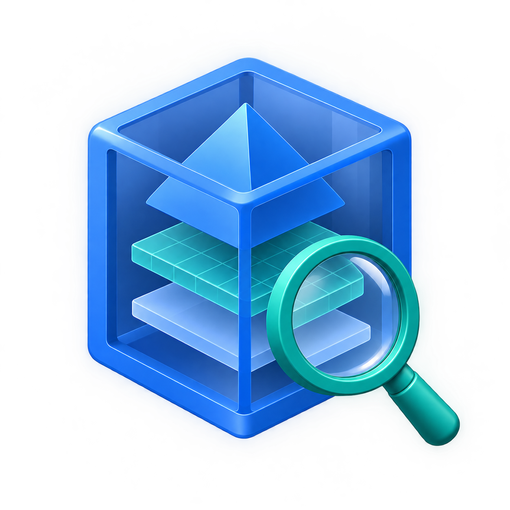

<p align="center">
  
</p>

<h1 align="center">USDZ Validation Kit</h1>

<p align="center">
  <strong>Local USDZ packaging, reference, and delivery-budget checks for Swift and the command line</strong>
</p>

<p align="center">
  <a href="Package.swift"></a>
  <a href="LICENSE"></a>
</p>

<p align="center">
  <a href="docs/cli.md">CLI guide</a> ·
  <a href="docs/inspection-boundary.md">Inspection limits</a> ·
  <a href="#use-the-library">Swift library</a> ·
  <a href="#logo-derived-3d-example">3D example</a>
</p>

## About

**USDZ Validation Kit** is a local Swift library and CLI for repeatable USDZ packaging, package-local reference, and delivery-budget checks. Native inspection runs without USD tools, extraction, or network access. No hosted upload or backend is used.

Reports distinguish observed defects from incomplete checks. **Exit `0` means the configured gate accepted the result**; it does not establish full USD conformance, Apple-platform compatibility, or asset-security certification. Complete reference coverage applies to the declared package-local authored-reference policy.

## Features

- **Packaging checks:** Inspect stored ZIP structure, payload alignment, CRC-32 integrity, and package member names.
- **Package-local references:** Inspect lexical USDA references and automatically read authored references in a bounded subset of exact USDC crate versions **0.8.0, 0.9.0, and 0.10.0** in version 0.2.0. Supported layers can achieve complete reference coverage; unsupported representations retain explicit gaps.
- **Delivery budgets:** Check archive, file, and encoded texture bytes, file counts, and supported texture dimensions against configurable thresholds.
- **Reports and gates:** Use text, deterministic JSON, or SARIF 2.1.0 reports with separate findings, coverage, and gate decisions.
- **Swift integration:** Use the `USDZValidation` library without process termination or stdout/stderr output, or run the `usdz-validator` executable.

## Build and run

### Prerequisites

- **Verified/supported current host:** macOS 27.0.1 build 26A434 / Xcode 27.1 build 27A9275 / Swift 6.4 (`swiftlang-6.4.0.34.1`) on arm64.
- **Intended compatibility, currently unverified:** macOS 15+ / Xcode 16.0 / Swift 6.0 on arm64. The package keeps its macOS 15 deployment and Swift 6 tools/language declarations.

No automatic minimum or future support is promised. Intel and non-macOS execution are outside v0.2 support. The badge above identifies the package's Swift tools declaration; it does not broaden verified compatibility.

### Build and validate a fixture

From the repository root:

```sh
swift build -c release --product usdz-validator
.build/release/usdz-validator validate Tests/Fixtures/valid-usda.usdz
```

The built executable is `.build/release/usdz-validator`; run it directly or copy it to a directory you manage on your `PATH`.

The original USDA fixture has complete native coverage and exits `0` with empty stderr. It contains no visible geometry and is a validation fixture, not a preview model. For a visible model, see the [logo-derived 3D example](#logo-derived-3d-example).

### Build dependencies

The first build may fetch the only CLI dependency, Swift Argument Parser 1.5.0, pinned in [Package.resolved](Package.resolved). The library privately compiles pinned LZ4 1.10.0 C source for bounded crate metadata decoding; no host-installed LZ4, Python, USD tool or OpenUSD runtime is needed. Source hashes and BSD-2-Clause terms are retained in [the dependency manifest](Sources/CUSDCCompression/source-manifest.json) and [NOTICE](NOTICE).

## Use the library

Add this package to a Swift package and select `.product(name: "USDZValidation", package: "usdz-validator")` for your target. From a local package dependency, use `.package(path: "/path/to/usdz-validator")`.

```swift
import Foundation
import USDZValidation

let configuration = try ValidationConfiguration()
let report = try Validator().validate(
    fileAt: URL(fileURLWithPath: "/path/to/asset.usdz"),
    configuration: configuration)
let json = try ReportEncoder.encode(report, format: .json)
// Use report.exitCode and report.coverage to apply your gate.
```

Validation reads one stable regular file. Malformed asset content returns findings; configuration, operational, and internal failures throw `ValidationError`. The library writes no stdout/stderr and does not terminate your process. Callers may project a typed failure with `ValidationReport(failure:fileAt:configuration:)` when they need a report envelope.

## Logo-derived 3D example

The project illustration inspired a procedural 3D reconstruction of its layered cube, with the magnifying glass omitted. Artwork generation and viewing use separate tools; the kit validates the USDZ package.

- [USDZ model](Examples/layered-cube/model.usdz)
- [Editable USD source](Examples/layered-cube/source/model.usda)
- [Saved native validation report](Examples/layered-cube/validation.json)

The [example guide](Examples/layered-cube/README.md) records provenance, checks, and the command to reproduce the report.

## Documentation

| Guide | What it covers |
| --- | --- |
| [CLI reference](docs/cli.md) | Executable examples, all options, profiles, budgets, exit codes, and the optional trusted-input checker |
| [Inspection boundary](docs/inspection-boundary.md) | Supported containers and references, coverage gaps, and resource limits |
| [Report contracts](docs/report-compatibility.md) | JSON/SARIF formats, compatibility, determinism, and occurrence identities |
| [Fixture provenance](docs/fixtures.md) | Test fixture origins and scope |
| [Offline schema tools](Tools/README.md) | Schema verification setup and independent golden provenance |

## Verification and support scope

### Development checks

```sh
swift test
sh Scripts/test-cli.sh
python3 Scripts/verify-examples.py --executable .build/release/usdz-validator
```

Run these from the repository root after the release build above. Offline schema setup is in [Tools/README.md](Tools/README.md).

### Verification evidence

Current-host required gates and their exact evidence are recorded in [envelope 3 verification](docs/verification/usdc-numeric-v0-2.md). The [envelope 2 acceptance record](docs/verification/usdc-v0-2.md) and [original release matrix](docs/verification/release-matrix.md) remain historical evidence.

CPython 3.14.7 is the verified schema-tool environment; macOS 15, other host/toolchain combinations, true cross-host equality and CPython 3.12 remain **UNVERIFIED**. Current-host `PASS` does not promote those deferred rows.

[Resource measurements](docs/verification/resource-results.md) test complete release CLI invocations against 268,435,456 bytes peak RSS and 60 seconds on the recorded host; they establish no universal memory guarantee.

### Inspection limits

Complete reference coverage describes the declared package-local authored-reference policy. It does not establish USD conformance, composed dependencies, geometry correctness or renderer compatibility. Admitted opaque numeric arrays require a bounded count header; their untouched element counts do not incur item or proportional work charges. Actual visits and enclosing containers remain charged. Expressions, clip templates, raw unregistered values, unknown representations and disputed layouts retain explicit gaps. ZIP entries remain stored-only; the sole decompression exception is bounded crate-internal metadata. See [the precise subset and envelope 3](docs/inspection-boundary.md).

### Outside v0.2 scope

- Complete USD parsing, composition/conformance, and geometry or scene validation.
- Editing, repair, conversion, normalization, rendering, and preview; GUI/web/backend services.
- Exhaustive Quick Look, RealityKit, visionOS, material, shader, animation, or visual-quality validation.
- ZIP decompression, image pixel decoding, and recursive nested inspection.
- Untrusted tools, `usdcat` conversion, and custom rule/resolver plugins.
- Intel/non-macOS execution and batch operation.
- Hosted SARIF upload, an external hard sandbox, product fixture generation, and extra executable products.

## Release history

For version 0.2.0 publication status, see [GitHub releases](https://github.com/Light2288/usdz-validator/releases). The `v0.1.0` tag remains available as the historical baseline; [the release summary](docs/verification/release-summary.md) preserves its original evidence and links the current verification. The [five local Apple sample results](docs/verification/apple-assets.md) describe historical v0.1 native gaps and separately opted-in checker results; they are not current v0.2 acceptance evidence.

See [CHANGELOG.md](CHANGELOG.md) for release history.

## Security

Vulnerability reporting and the native/external-tool security boundaries are described in [SECURITY.md](SECURITY.md). Optional installed-checker execution requires trusted input and remains separate from native inspection and coverage; see the [checker policy](docs/cli.md#optional-installed-checker).

## License

Original code, documentation, project-authored fixtures, branding artwork, and the layered-cube example are MIT, copyright 2026 USDZ Validation Kit contributors. Preserve [LICENSE](LICENSE) and applicable [NOTICE](NOTICE) material when redistributing. The bundled LZ4 source retains its BSD-2-Clause terms.
